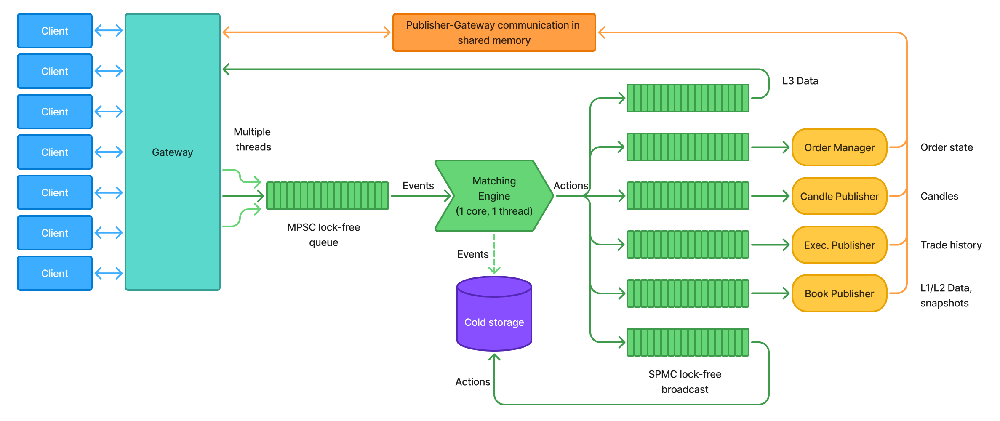

[](https://github.com/SerbanUntu/exchange/actions/workflows/build.yml)
[](https://codecov.io/gh/SerbanUntu/exchange)
[](https://serbanuntu.github.io/exchange/)

## Contents

- [Overview](#overview)
- [Verification](#verification)
  - [Mutation Testing](#mutation-testing)
  - [Differential Testing](#differential-testing)
  - [Fuzzing](#fuzzing)
  - [Running the Tests](#running-the-tests)
  - [Continuous Integration](#continuous-integration)
  - [Documentation](#documentation)
- [Codebase](#codebase)
  - [Architecture](#architecture)
  - [Dependencies](#dependencies)
  - [Codebase Structure](#codebase-structure)
- [Usage](#usage)
  - [Building](#building)
  - [Running the Server](#running-the-server)
  - [Using `just`](#using-just)

# Stock Exchange



## Overview

A stock exchange written in C++20, built as a set of separate processes that communicate through shared memory. Clients connect over gRPC. The core is a matching engine that keeps an order book for every security and matches buy and sell orders by price, then by arrival time. It supports limit and market orders, the GTC, IOC and FOK time in force options, and cancelling and amending orders. Separate services turn the output of the matching engine into market data, such as order book snapshots (L1 and L2) and candlestick (OHLCV) data.

Besides unit tests, the matching logic is verified with mutation testing, differential testing and fuzzing, and every push is built and tested in 12 compiler and sanitizer configurations.

The project is a work in progress. The matching engine, the order book publisher and the candlestick publisher are implemented and tested. The gateway currently answers the securities lookups, and the execution publisher, order manager and archiver are placeholders. [SPEC.md](./SPEC.md) describes the full target design.

## Verification

### Mutation Testing

Mutation testing checks the quality of the tests themselves. Small bugs (mutants) are added to the source code on purpose, and a good test suite should fail for each of them. 15 handwritten mutants, stored as git patches, are applied one at a time and the tests are run against each. The first run caught 12 of the 15, and the surviving mutants led to new tests. See [MUTATION_TESTING.md](./MUTATION_TESTING.md) for the approach and the full results.

### Differential Testing

The matching engine is compared against a simple reference implementation with the same logic. Every handwritten test, and 20,000 randomly generated sequences of orders on every run, are sent to both, and the test fails if their outputs differ. One million random sequences were also run locally without a single difference. See [DIFFERENTIAL_TESTING.md](./DIFFERENTIAL_TESTING.md).

### Fuzzing

The matching engine is fuzzed with libFuzzer, which generates millions of order sequences and moves towards inputs that reach new code (coverage-guided fuzzing). The order book checks its own invariants with assertions, such as the best buy price always being below the best sell price, and the fuzzer reports any input that breaks one of them or triggers a memory error. A 10-minute run in CI executed almost 6 million sequences without finding an issue. See [FUZZING.md](./FUZZING.md).

### Running the Tests

Tests are built alongside the project and registered with CTest:

```sh
ctest --test-dir cmake-build-release/build/Release --output-on-failure
```

Or `just test`. Other variants:

- `just test-with-asserts` builds into `cmake-build-asserts` with the order book invariant checks enabled, and runs the tests.
- `just san address,undefined` and `just san-with-asserts address,undefined` build and test with sanitizers (any of `address`, `undefined` or `thread`). MSVC only supports `address`.
- `just mutations` runs all mutants (Bash scripts).
- The `DIFFERENTIAL_TEST_SEEDS` environment variable sets how many random sequences the differential test runs.
- Fuzzing needs Clang on Linux. Configure with `-DFUZZ=ON -DASSERTS=ON -DSANITIZERS=address,undefined` and run `exchange-server-matching-engine-fuzzer` with an output directory and `server/matching_engine/fuzzing/seeds`. In every other build, the same target replays the seeds as part of the regular tests.

### Continuous Integration

Every push runs the `build` GitHub Actions workflow:

- **Formatting**: `clang-format` checks every source file.
- **Audit**: `conan audit` scans the dependencies for known vulnerabilities.
- **Static analysis**: `clang-tidy` runs with all warnings treated as errors.
- **Build and test matrix**: 12 configurations covering GCC and Clang, `-O0` and `-O3`, each without sanitizers, with ASan and UBSan, and with TSan. All of them run with the order book invariant checks enabled.
- **Mutation testing**: runs all mutants and uploads the results as an artifact.
- **Fuzzing**: fuzzes the matching engine for 60 seconds with ASan and UBSan, and uploads any crashing input.
- **Coverage**: measures the line and branch coverage of the tests and of the fuzzer, and uploads both to [Codecov](https://codecov.io/gh/SerbanUntu/exchange).

Dependencies are installed with Conan in every job, and the downloaded packages are cached between runs. The formatting and linting checks can also be run locally:

#### Formatting

```sh
find client common server -type f \( -name '*.cpp' -o -name '*.h' -o -name '*.hpp' \) -print0 | xargs -0 --no-run-if-empty clang-format -i
```

#### Linting

Requires the project to have been built first (see [Building](#building)), since clang-tidy reads the compile commands from the build output.

```sh
find client common server -type f \( -name '*.cpp' -o -name '*.h' -o -name '*.hpp' \) -not -path '*/test/*' -print0 | xargs -0 --no-run-if-empty clang-tidy -p cmake-build-release/build/Release
```

### Documentation

The API documentation is generated from the source comments with Doxygen and published to [GitHub Pages](https://serbanuntu.github.io/exchange/) by the `docs` workflow on every push to `main`. To generate it locally:

```sh
doxygen
```

Output is written to `docs/html`.

Documentation about the public gRPC API of the exchange can be found in [the dedicated README](./proto/README.md).

## Codebase

### Architecture

Each component runs as its own process, as shown in the diagram above. The gateway receives requests from clients over gRPC, and order requests are written as events to a shared memory queue. The matching engine is the only reader of that queue. It runs on a single thread pinned to one CPU core, applies each event to the order book of its security, and broadcasts the resulting actions (trades, added, resized and removed orders) on a second shared memory queue. The publishers, the order manager and the gateway read from that broadcast queue to build their own view of the market. The queues are Aeron ring buffers placed in shared memory created with Boost.Interprocess. See [SPEC.md](./SPEC.md) for the full design.

### Dependencies

- [CMake](https://cmake.org/download/) >= 4.2
- [Ninja](https://ninja-build.org/)
- [Python](https://www.python.org/downloads/) + [pip](https://pip.pypa.io/) (used to install Conan)
- [Conan](https://conan.io/) 2.x (`pip install conan`)
- A C++20 compiler

The libraries are installed by Conan from `conanfile.txt`: gRPC, Protobuf, spdlog, Aeron, Boost, GoogleTest, oneTBB, concurrentqueue, libcurl, nlohmann_json and uWebSockets.

#### Windows

On Windows, I recommend **MSVC**, to avoid issues with Conan. Install it via the [Visual Studio Installer](https://visualstudio.microsoft.com/downloads/) with the "Desktop development with C++" package.

When selecting individual components, install the **MSVC v143 (VS 2022) build tools** specifically, rather than the newer v144 toolset. Most prebuilt binary packages on [ConanCenter](https://conan.io/center) are currently built against v143, so using it avoids Conan falling back to `--build=missing` and rebuilding dependencies from source.

#### Optional

Only needed if you want to run formatting, linting, or docs generation, or use the `just` aliases below:

- [just](https://github.com/casey/just) (command runner providing short aliases for the commands below)
- [clang-format](https://clang.llvm.org/docs/ClangFormat.html) (code formatting)
- [clang-tidy](https://clang.llvm.org/extra/clang-tidy/) (linting)
- [Doxygen](https://www.doxygen.nl/) (+ [Graphviz](https://graphviz.org/) for call graphs) for documentation generation

### Codebase Structure

Every module follows the same layout, with public headers under `include/`, the implementation under `src/` and the tests under `test/`. The executables in `apps/` only call into these modules.

```
exchange/
  apps/                       # Executable entry points, one per process plus the client
  client/                     # Example client that queries the gateway
  common/                     # Code shared by the client and the server
  proto/                      # gRPC API definitions
  server/
    common/                   # Order book, shared memory queues and domain model
    gateway/                  # gRPC entry point for clients
    matching_engine/          # Matching engine
      fuzzing/                # Fuzz target, input encoding and seeds
      test/                   # Unit, differential and randomized tests
    orderbook_publisher/      # L1 and L2 order book data
    candlestick_publisher/    # OHLCV candles
    execution_publisher/      # Fill history (placeholder)
    order_manager/            # State of individual orders (placeholder)
    archiver_process/         # Persistence (placeholder)
  mutation_testing/           # Mutant patches and the scripts that run them
  cmake/                      # CMake options for optimization, sanitizers, coverage, asserts and fuzzing
  assets/                     # README images
  .github/                    # CI workflows
  CMakeLists.txt              # Top-level build configuration
  conanfile.txt               # Conan dependencies
  Justfile                    # Build, test, lint and CI recipes
  Doxyfile                    # Doxygen configuration
  SPEC.md                     # Target system design
  MUTATION_TESTING.md
  DIFFERENTIAL_TESTING.md
  FUZZING.md
```

## Usage

### Building

1. Detect your Conan profile (first time only):

   ```sh
   conan profile detect --force
   ```

2. Install dependencies and generate the CMake toolchain/presets:

   ```sh
   conan install . --build=missing --output-folder=cmake-build-release
   ```

3. Configure the project:

   ```sh
   cmake --preset conan-release
   ```

4. Build:

   ```sh
   cmake --build --preset conan-release
   ```

On Windows, run these from a Visual Studio developer shell. The equivalent `just` commands are `just install` and `just build`.

### Running the Server

The executables are placed under `cmake-build-release/build/Release/apps/`. The matching engine creates the shared memory, so it has to start first, followed by the publishers and then the gateway, each in its own terminal:

```sh
./cmake-build-release/build/Release/apps/server/matching_engine/matching-engine
./cmake-build-release/build/Release/apps/server/orderbook_publisher/orderbook-publisher
./cmake-build-release/build/Release/apps/server/candlestick_publisher/candlestick-publisher
# Other publishers
./cmake-build-release/build/Release/apps/server/gateway/gateway
```

The gateway listens on port 8989. The example client connects to it and requests the list of securities once per second:

```sh
./cmake-build-release/build/Release/apps/client/client
```

### Using `just`

There is a `Justfile` with short aliases for the commands above (and a few extras like dependency auditing and simulated CI dry-runs via `act`). Once `just` is installed, run commands from the repo root:

```sh
just install   # conan install
just build     # cmake configure + build
just test      # ctest
just format    # clang-format -i
just lint      # clang-tidy
just docs      # doxygen
just check     # format check, audit, install, build, lint, test
just fix       # format, install, build, lint-fix
```

Run `just --list` to see all available aliases.
